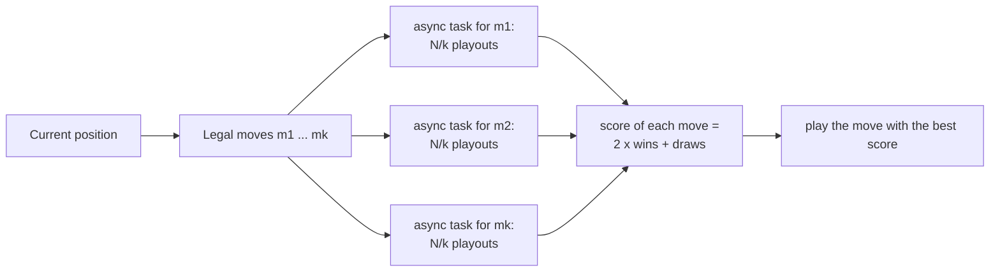

# Ultimate Tic-Tac-Toe AI

**Two game-playing engines in C++17, Minimax with alpha-beta pruning and Monte Carlo simulation, built to beat a school arena AI at Ultimate Tic-Tac-Toe.**

[](https://github.com/Nayl-git/ultimate-tic-tac-toe-ai/actions/workflows/ci.yml)


Team project at ESILV (May 2026). In the school arena, our Monte Carlo engine **won 97 of 100 games** against the arena AI at the `MEDIUM_1` level.

## The game

- The board is a 3x3 grid of small tic-tac-toe boards (81 cells). Win a small board with three in a row; win the game with three small boards in a row.
- The cell you play decides where your opponent must play next: playing the top-right cell of any small board sends them to the top-right small board.
- If that board is already finished (won or full), the opponent may play in any open board. Drawn small boards count for nobody; if every small board is finished without a line, the game is a draw.

## The goal

The assignment was to write an AI that plays against the school's arena AI, a strong opponent built on game-search algorithms with 8 difficulty levels, from easy to very hard. The arena gives our program the opponent's move, we answer with ours, and it counts the results over a series of games.

We wrote the rules engine and two independent AIs. The final arena program uses the Monte Carlo engine; the Minimax call is still there, commented out.

## How the engines work

Both engines share the rules engine: `Morpion` (one small board: win/draw detection, free cells) and `Plateau` (the 9 small boards, the "sent to board" rule, legal move generation, move history with undo). Both return immediately when only one move is legal, and both evaluate the candidate moves in parallel, with one `std::async` task per legal move.

### Minimax with alpha-beta pruning ([`src/Minimax.cpp`](src/Minimax.cpp))

- **Search:** depth-limited minimax with alpha-beta pruning. Moves are applied and undone in place (`appliquerCoup` / `annulerDernierCoup`) instead of copying the board at each node.
- **Move ordering:** before searching, moves are sorted by the position of the cell inside its small board: centre first, then corners, then edges. Good moves first means more cut-offs.
- **Evaluation** at the depth limit: +10 for each small board we own, −10 for each one the opponent owns, with an extra ±5 for the centre board.
- **Terminal positions:** a win scores 10000 plus the remaining depth and a loss −10000 minus the remaining depth, so the engine prefers fast wins and slow losses.
- **Parallel root:** each legal move at the root is searched in its own `std::async` task, on its own copy of the board and with its own alpha-beta window.

### Monte Carlo simulation ([`src/MonteCarlo.cpp`](src/MonteCarlo.cpp))

- **Budget:** a total of N playouts per decision (N = 2600 in the arena), split evenly across the legal moves (`N / number of legal moves` each).
- **Playouts:** from the position after the candidate move, the game is played to the end with a light policy (below) rather than purely random moves: it never misses an immediate game-winning move and takes cells the opponent would win the game with.
- **Scoring:** 2 points per playout won, 1 per draw, 0 per loss. The move with the highest total is played.



Playout policy, at every turn of a simulated game:

```
1. one of my legal moves wins the whole game      -> play it
2. the opponent would win the whole game
   by taking one of my legal cells                -> take that cell
3. otherwise                                      -> random legal move
```

## Results

### In the school arena

| Opponent | Our engine | Result |
|---|---|---|
| Arena AI, level `MEDIUM_1` | Monte Carlo, budget of 2600 playouts per decision | **97 wins out of 100 games** |

This result was obtained in the school's arena. It cannot be reproduced from this repository, because the arena library belongs to the school and is not published here.

### Measured with the standalone runner

To make the engines runnable by anyone, this public version adds a match runner ([`standalone/uttt_match.cpp`](standalone/uttt_match.cpp)) that plays the engines against each other or against a uniform-random player, alternating who moves first. These are the numbers we measured with it (200 games each, results from the first engine's point of view):

| Match | Settings | Wins / draws / losses | Average time per move |
|---|---|---|---|
| Monte Carlo vs random | 2600 playouts per decision, seed 1 | 199 / 1 / 0 | 22.3 ms |
| Minimax vs random | depth 6, seed 1 | 190 / 8 / 2 | 2.7 ms |
| Monte Carlo vs Minimax | 2600 playouts vs depth 6, seed 1, first 2 plies random | 109 / 26 / 65 | 20.0 ms vs 4.1 ms |

Measured on Windows 11, Intel Core Ultra 7 258V (8 cores), Clang 21 (`-O2`). Timings depend on the machine and on the number of cores, since both engines evaluate candidate moves in parallel.

Minimax is deterministic, and so is Monte Carlo on Windows (see [Known limitations](#known-limitations)), so a Monte Carlo vs Minimax match without random openings repeats the same two games: Minimax won both. The `--opening 2` option plays the first two plies at random to get varied games.

Reproduce with:

```bash
./build/uttt_match --a montecarlo --b random  --games 200 --sims 2600 --seed 1
./build/uttt_match --a minimax    --b random  --games 200 --depth 6   --seed 1
./build/uttt_match --a montecarlo --b minimax --games 200 --sims 2600 --depth 6 --seed 1 --opening 2
```

On Windows these runs are exactly reproducible. On Linux, the Monte Carlo playouts share one `rand()` state between threads, so expect close but not identical numbers.

## Build and run

Requirements: a C++17 compiler (tested with GCC in CI and Clang locally) and CMake 3.20 or later.

```bash
cmake -S . -B build -DCMAKE_BUILD_TYPE=Release
cmake --build build --parallel
ctest --test-dir build --output-on-failure

./build/uttt_match --a montecarlo --b random --games 100 --seed 1
./build/uttt_match --a minimax --b random --games 2 --depth 4 --verbose   # prints the final boards
```

Without CMake, one command builds the runner:

```bash
g++ -std=c++17 -O2 -pthread -Isrc src/*.cpp standalone/uttt_match.cpp -o uttt_match
```

Runner options: `--a` and `--b` (`montecarlo`, `minimax` or `random`), `--games`, `--sims` (Monte Carlo playouts per decision, default 2600), `--depth` (Minimax depth, default 4), `--seed`, `--opening` (random plies at the start of each game), `--verbose`. The runner checks that every move an engine returns is legal.

The unit tests ([`tests/test_main.cpp`](tests/test_main.cpp)) cover small-board and global win detection (rows, columns, diagonals, draws), the "sent to board" rule for all 81 cells, free choice when the target board is finished, legal move counts, apply/undo consistency over 50 random games, Minimax taking an immediate win and blocking an immediate loss, and Monte Carlo returning legal moves and taking an immediate win.

## Repository structure

```
.
├── src/                  the team's engine (unchanged, converted to UTF-8)
│   ├── Morpion.*         one small board: cells, win/draw detection
│   ├── Plateau.*         the 9 small boards: rules, legal moves, undo
│   ├── Minimax.*         Minimax with alpha-beta pruning
│   ├── MonteCarlo.*      Monte Carlo simulation engine
│   └── main.h            GameMove and TAILLE, added for this public version
├── arena/                original entry point for the school arena (not buildable alone)
│   ├── main.cpp
│   └── README.md
├── standalone/           match runner, added for this public version
├── tests/                unit tests, added for this public version
├── CMakeLists.txt
└── .github/workflows/ci.yml
```

The code comments and identifiers are in French, as written for the course (`Plateau` = board, `Morpion` = tic-tac-toe, `coup` = move, `EtatCase::J1` / `J2` = player 1 / player 2).

## What is not included, and why

- **The school's arena library** (`libUTTTLib.a`), the Allegro DLLs it needs and the template header that declares the arena interface: they belong to the school. `src/main.h` replaces the header with the two definitions the engine needs. [`arena/main.cpp`](arena/main.cpp) therefore does not build on its own; the standalone runner replaces it.
- **Build artefacts and IDE files** (executables, object files, Code::Blocks project files, the arena's images).

## Known limitations

- The Monte Carlo playouts call `std::rand()` from several threads. With the Windows C runtime, every thread has its own `rand()` state starting from the same seed, so the `srand(time)` call in `arena/main.cpp` does not reach the playouts and the engine is deterministic for a given position; with glibc, the threads share one state. A random generator per task (for example `std::mt19937`) would make it portable and seedable.
- The parallel Minimax root gives each task its own alpha-beta window, so cut-offs found in one root branch do not help the others: parallelism is traded for some pruning.
- `Plateau::appliquerCoup` records a move in the history even if the cell was already taken (the move itself is ignored), so undoing it would clear the other player's cell. The engines only play legal moves, so this never happens in a game.

## Credits

Team project at [ESILV](https://www.esilv.fr/) (May 2026) by Nayl Saifoudine and two teammates, with equal contributions.

The arena, its AI and the template interface were provided by the school and are not published here.
